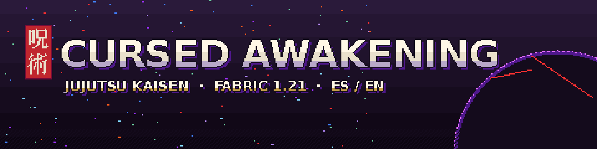

<h1 align="center">Jujutsu Kaisen: Cursed Awakening</h1>

  <b>A Jujutsu Kaisen RPG for Fabric 1.21.1</b> 
  Be born a sorcerer, a Heavenly Restriction or a Vessel, awaken an innate technique, master it fighting cursed spirits and climb from Grade 4 to Special Grade until you open your own <b>Domain Expansion</b>.

  
  
  
  
  

  <b>English</b> · <a href="README_ES.md">Español</a>

---

<!-- Screenshots: put the images in .github/assets/ and uncomment.

   
   

-->

## ✨ Features

- **30 innate techniques**, each with its own **Maximum Technique** and **Domain Expansion**: Limitless, Shrine, Ten Shadows (Mahoraga included), Cursed Speech, Ratio, Blood Manipulation, Copy (Yuta and Rika), Cursed Spirit Manipulation, Judgeman, Straw Doll, Boogie Woogie, Projection, Idle Death Gamble, Construction, Star Rage and more.
- **Real domains:** a dome built from actual blocks with its own interior, sure-hit effects, **domain clashes**, barriers you can break and defenses (Simple Domain, Hollow Wicker Basket, Falling Blossom Emotion, Domain Amplification). The terrain is always restored.
- **RPG progression on three axes:** level and **9 stats** you spend yourself, **Technique Mastery** (M1–M10) that grows with use, and **Grade** (G4 → Special) that unlocks abilities.
- **25 Jujutsu Arts:** Reinforcement, Black Flash and the Zone, Reverse Cursed Technique, Binding Vows, Veil, Sensing, CE Guard… with burnout and **brain damage** as real consequences.
- **Origins, species and traits:** Human or Curse, latent traits, Six Eyes and the Gojo, Zen'in, Inumaki and Kamo lineages.
- **Potential Vessel:** receive a host spirit — **Sukuna** (eat his fingers), Ryu Ishigori, Uraume, the Angel, Yorozu, Uro, Kenjaku or Kashimo — and use their technique… until they take over.
- **Six bosses** with their own structures and Guardian versions: Satoru Gojo, Ryomen Sukuna, Suguru Geto, Kenjaku, Toji Fushiguro and Yuta Okkotsu.
- **Disaster curses** (Jogo, Hanami, Dagon, Mahito) and **40 cursed spirits** with their own models, plus **sorcerer NPCs** that use the same techniques as you.
- **Weapons from the series in 3D** at real size, cursed tools, copper and amethyst gear, cursed food and rituals.
- **Your own interface:** HUD, status cards and the Sorcerer Screen (**K**) with every ability's numbers. English and Spanish.

👉 Everything explained in the **[Wiki](https://github.com/Megambit-mc/cursed-awakening/wiki)**.

## 📥 Download and install

**Download:** [CurseForge](https://www.curseforge.com/minecraft/mc-mods/cursed-awakening-jjk) · [Modrinth](https://modrinth.com/mod/cursed-awakening-jjk)

| | Version |
|---|---|
| Minecraft | 1.21.1 |
| Fabric Loader | 0.18.4 or newer |
| [Fabric API](https://modrinth.com/mod/fabric-api) | 0.116.17+1.21.1 or newer |
| Java | 21 |

1. Install [Fabric Loader](https://fabricmc.net/use/installer/) for Minecraft 1.21.1.
2. Put **Fabric API** and the mod's `.jar` in your `mods` folder.
3. On servers, the mod goes **on the server and on every client**.

Cardinal Components API and Player Animation Library are included in the mod. [Mod Menu](https://modrinth.com/mod/modmenu) and [EMI](https://modrinth.com/mod/emi) are optional.

## 🎮 Controls

All keys can be changed in *Options → Controls → JJK*.

| Key | Action |
|---|---|
| **V** | Use the selected ability (tap, hold to charge, or hold to keep it on) |
| **G** / **Shift + G** | Next / previous ability |
| **Hold G + scroll** | Browse your abilities |
| **Z** | Switch list: Technique ↔ Arts · **hold Z** to use your Arts for a moment |
| **R** | Reinforcement |
| **C** / **Shift + C** (hold) | Reverse Technique on yourself / on someone else |
| **X** (hold) | Sensing |
| **B** (hold) | CE Guard |
| **Alt + scroll** | Effort ±10% |
| **K** | Sorcerer Screen |
| **H** | HUD mode |

More in **[Controls](https://github.com/Megambit-mc/cursed-awakening/wiki/Controls)**.

## 🖥️ For servers

- `/gamerule jjkTerrainDamage false` turns off all terrain damage from techniques.
- Every balance value is in `config/jjk.json` (created on first start); `/ce config reload` reloads it.
- More in the **[Server guide](https://github.com/Megambit-mc/cursed-awakening/wiki/Server-Guide)**.

## 🐛 Bugs, ideas and art

- **Found a bug?** [Open an issue](https://github.com/Megambit-mc/cursed-awakening/issues/new/choose) with the template.
- **Have an idea?** Post it in [Discussions → Ideas](https://github.com/Megambit-mc/cursed-awakening/discussions/categories/ideas) and vote for others.
- **Made art for the mod?** Share it in [Discussions → Art](https://github.com/Megambit-mc/cursed-awakening/discussions/categories/art).
- **What's coming:** the [roadmap](https://github.com/Megambit-mc/cursed-awakening/milestones) and the [changelog](CHANGELOG.md).

Read [CONTRIBUTING](.github/CONTRIBUTING.md) before you post.

## 📜 Credits

Made by **Megambit**. *Jujutsu Kaisen* is the work of Gege Akutami. This is a fan project with no official relation to the series or its publishers.
