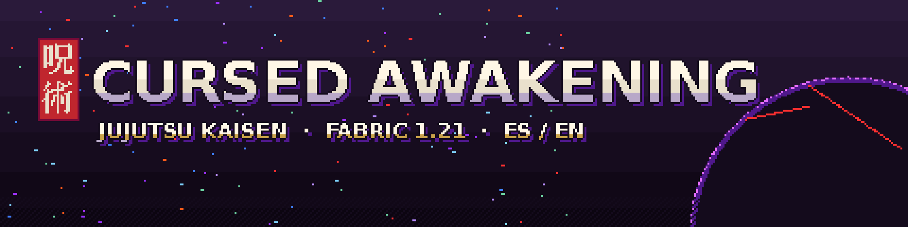

<h1 align="center">Jujutsu Kaisen: Cursed Awakening</h1>

  <b>Un RPG de Jujutsu Kaisen para Fabric 1.21.1</b> 
  Naces hechicero, Restricción Celestial o Vasija; despiertas una técnica innata; la dominas combatiendo contra espíritus malditos y asciendes de Grado 4 a Grado Especial hasta desplegar tu propia <b>Expansión de Dominio</b>.

  
  <!-- MODRINTH:  -->
  
  
  

  <a href="README.md">English</a> · <b>Español</b>

---

<!-- Capturas: guarda las imágenes en .github/assets/ y quita el comentario.

   
   

-->

## ✨ Qué trae

- **30 técnicas innatas**, cada una con su **Técnica Máxima** y su **Expansión de Dominio**: Ilimitado, Santuario, Diez Sombras (con Mahoraga), Discurso Maldito, Proporción 7:3, Manipulación de Sangre, Copia (Yuta y Rika), Manipulación de Espíritus Malditos, Técnica del Juez, Muñeco de Paja, Boogie Woogie, Proyección, Apuesta Pasiva Mortal, Construcción, Furia Estelar y más.
- **Dominios reales:** una cúpula de bloques de verdad con interior propio, golpe garantizado, **choque de dominios**, barreras que se rompen y defensas (Dominio Simple, Canasta de Mimbre Hueca, Emoción de Pétalos Caídos, Amplificación de Dominio). El terreno siempre se restaura.
- **Progresión RPG en tres ejes:** nivel y **9 stats** que repartes tú, **Maestría** de la técnica (M1–M10) que sube al usarla y **Grado** (G4 → Especial) que desbloquea habilidades.
- **25 Artes Jujutsu:** Reforzamiento, Destello Negro y la Zona, Técnica Inversa, Votos Vinculantes, Velo, Sensing, Guardia de CE… con agotamiento y **daño cerebral** como consecuencias reales.
- **Orígenes, especies y rasgos:** Humano o Maldición, rasgos latentes, Seis Ojos y los linajes Gojo, Zenin, Inumaki y Kamo.
- **Vasija Potencial:** recibe a un espíritu anfitrión —**Sukuna** (comiendo sus dedos), Ryu Ishigori, Uraume, el Ángel, Yorozu, Uro, Kenjaku o Kashimo— y usa su técnica… hasta que toma el control.
- **Seis jefes** con su estructura y su versión guardián: Satoru Gojo, Ryomen Sukuna, Suguru Geto, Kenjaku, Toji Fushiguro y Yuta Okkotsu.
- **Maldiciones catástrofe** (Jogo, Hanami, Dagon, Mahito) y **40 espíritus malditos** con modelo propio, además de **hechiceros NPC** que usan las mismas técnicas que tú.
- **Armas de la serie en 3D** a escala real, herramientas malditas, equipo de cobre y amatista, comida maldita y rituales.
- **Interfaz propia:** HUD, tarjetas de estado y la Pantalla del Hechicero (**K**) con las cifras de cada habilidad. En español e inglés.

👉 Todo explicado en la **[Wiki](https://github.com/Megambit-mc/cursed-awakening/wiki/Inicio)**.

## 📥 Descarga e instalación

**Descarga:** [CurseForge](https://www.curseforge.com/minecraft/mc-mods/megambits-jjkcraft)

| | Versión |
|---|---|
| Minecraft | 1.21.1 |
| Fabric Loader | 0.18.4 o superior |
| [Fabric API](https://modrinth.com/mod/fabric-api) | 0.116.17+1.21.1 o superior |
| Java | 21 |

1. Instala [Fabric Loader](https://fabricmc.net/use/installer/) para Minecraft 1.21.1.
2. Copia **Fabric API** y el `.jar` del mod en la carpeta `mods`.
3. En servidores, el mod va **en el servidor y en todos los clientes**.

Cardinal Components API y Player Animation Library van incluidos. [Mod Menu](https://modrinth.com/mod/modmenu) y [EMI](https://modrinth.com/mod/emi) son opcionales.

## 🎮 Controles

Todas las teclas se cambian en *Opciones → Controles → JJK*.

| Tecla | Acción |
|---|---|
| **V** | Usar la habilidad seleccionada (pulsar, mantener para cargar o mantener activa) |
| **G** / **Shift + G** | Siguiente / anterior habilidad |
| **G mantenida + rueda** | Recorrer tus habilidades |
| **Z** | Cambiar de lista: Técnica ↔ Artes · **Z mantenida**: usar tus Artes un momento |
| **R** | Reforzamiento |
| **C** / **Shift + C** (mantener) | Técnica Inversa propia / sobre otro |
| **X** (mantener) | Sensing |
| **B** (mantener) | Guardia de CE |
| **Alt + rueda** | Esfuerzo ±10 % |
| **K** | Pantalla del Hechicero |
| **H** | Modo del HUD |

Más en **[Controles](https://github.com/Megambit-mc/cursed-awakening/wiki/Controles)**.

## 🖥️ Para servidores

- `/gamerule jjkTerrainDamage false` desactiva toda la destrucción de terreno de las técnicas.
- Todo el balance está en `config/jjk.json` (se crea al arrancar); `/ce config reload` lo recarga.
- Más en la **[Guía para servidores](https://github.com/Megambit-mc/cursed-awakening/wiki/Guia-para-servidores)**.

## 🐛 Errores, ideas y arte

- **¿Encontraste un error?** [Abre un issue](https://github.com/Megambit-mc/cursed-awakening/issues/new/choose) con la plantilla.
- **¿Tienes una idea?** Publícala en [Discussions → Ideas](https://github.com/Megambit-mc/cursed-awakening/discussions/categories/ideas) y vota las de otros.
- **¿Hiciste arte para el mod?** Compártelo en [Discussions → Art](https://github.com/Megambit-mc/cursed-awakening/discussions/categories/art).
- **Lo que viene:** el [roadmap](https://github.com/Megambit-mc/cursed-awakening/milestones) y el [changelog](CHANGELOG.md) (en inglés).

Lee [CONTRIBUTING](.github/CONTRIBUTING.md) antes de publicar.

## 📜 Créditos

Hecho por **Megambit**. *Jujutsu Kaisen* es obra de Gege Akutami. Este es un proyecto de fans sin relación oficial con la obra ni con sus editores.
